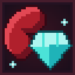

<p align="center">
  
</p>

<h1 align="center">Organ Market</h1>

<p align="center">
  A Fabric mod for Minecraft 26.3 where you sell your organs for diamonds, and pay for it until you buy them back.
</p>

<p align="center">
  <a href="#english">English</a> · <a href="#русский">Русский</a>
</p>

---

<a name="english"></a>

# English

## What is this?

**Organ Market** adds a black market to Minecraft. Open it, pick an organ, and sell it for a pile of diamonds. The catch: every organ you sell leaves you with a **permanent debuff**. It survives death, relogging and milk buckets, and it only goes away when you pay to buy the organ back, at a much higher price than you were paid.

Sell now, suffer later. Is it worth it?

## Features

- **Four organs to sell:** stomach, kidney, lung and eye.
- **Permanent debuffs** that are *not* potion effects, so milk and totems can't remove them.
- **Buyback:** get the organ (and your health, speed or vision) back for 2.5x what you were paid.
- **Prices depend on the world seed.** In one world an eye might sell for 8 diamonds, in another it might be worth more than a kidney. The same world always has the same prices.
- **A black market screen** opened with a key, with one button per organ. Prices update live.
- **Everything is checked on the server**, so the client can't cheat its way to free diamonds.

## Organs and debuffs

| Organ | ID | Debuff while sold |
|---|---|---|
| Stomach | `stomach` | Food restores only half as much hunger and saturation |
| Kidney | `kidney` | −2 hearts of maximum health |
| Lung | `lung` | −15% movement speed, and sprinting drains hunger twice as fast |
| Eye | `eye` | Tunnel vision (screen edges go dark), −30% attack damage, shorter reach |

Each organ can be sold once, and bought back once per sale.

## Prices

- Selling pays a random amount between **6 and 32 diamonds**, decided per organ by the **world seed**.
- Buying an organ back costs **2.5 times** its sale price (rounded), so selling is always a loan with interest.
- You need enough free inventory space to receive the diamonds; otherwise the sale is refused and nothing happens.

## Controls

| Action | How |
|---|---|
| Open the black market | Press **J** (rebindable in *Options → Controls → Key Binds*) |
| Show organs, prices and status | `/organ list` |
| Sell an organ | `/organ sell <stomach\|kidney\|lung\|eye>` |
| Buy an organ back | `/organ buy <stomach\|kidney\|lung\|eye>` |

The commands support Tab completion.

## Installation

1. Install [Fabric Loader](https://fabricmc.net/use/installer/) **0.20.1 or newer** for Minecraft **26.3**.
2. Download [Fabric API](https://modrinth.com/mod/fabric-api) for 26.3 and put it into your `mods` folder.
3. Put the Organ Market `.jar` into the same `mods` folder.
4. Run the game with **Java 25**.

Optional: install [Mod Menu](https://modrinth.com/mod/modmenu) to see the mod's description and icon in the in-game mod list.

## Building from source

You need **JDK 25**.

```bash
git clone <this repository>
cd organ-market
./gradlew build
```

The finished mod will be in `build/libs/`. Use the file without `-sources` in its name. To try it in a development client:

```bash
./gradlew runClient
```

## Notes and known limitations

- Made for **Minecraft 26.3 only**. Newer versions changed a lot of APIs, so other versions are not supported.
- This is an early version and has mostly been tested in **singleplayer**. The market screen and the tunnel vision effect are client-side, so players on a server need the mod installed on their client too.
- Debuff numbers (hearts, speed, price range) are plain constants in the code and easy to rebalance.

## License

CC0-1.0, as declared in `fabric.mod.json`.

---

<a name="русский"></a>

# Русский

## Что это?

**Organ Market** добавляет в Minecraft чёрный рынок. Открываешь его, выбираешь орган и продаёшь за кучу алмазов. Но есть подвох: каждый проданный орган оставляет **постоянный дебаф**. Он не пропадает ни после смерти, ни после перезахода, ни от молока, и исчезает только когда ты выкупишь орган обратно за гораздо большую цену, чем получил.

Продай сейчас, плати потом. Стоит ли оно того?

## Возможности

- **Четыре органа на продажу:** желудок, почка, лёгкое и глаз.
- **Постоянные дебафы**, которые *не являются* эффектами зелий, поэтому молоко и тотемы их не снимают.
- **Выкуп:** вернуть орган (а с ним здоровье, скорость или зрение) можно за цену в 2,5 раза выше той, что тебе заплатили.
- **Цены зависят от сида мира.** В одном мире глаз может стоить 8 алмазов, в другом он будет дороже почки. В одном и том же мире цены всегда одинаковые.
- **Экран чёрного рынка**, который открывается клавишей, с отдельной кнопкой на каждый орган. Цены на кнопках обновляются сразу.
- **Всё проверяется на сервере**, так что клиент не может схитрить и получить алмазы бесплатно.

## Органы и дебафы

| Орган | ID | Дебаф, пока орган продан |
|---|---|---|
| Желудок | `stomach` | Еда восстанавливает вдвое меньше голода и сытости |
| Почка | `kidney` | −2 сердца максимального здоровья |
| Лёгкое | `lung` | −15% к скорости, а бег тратит голод вдвое быстрее |
| Глаз | `eye` | Туннельное зрение (края экрана темнеют), −30% урона, меньше дальность руки |

Каждый орган можно продать один раз, а после продажи один раз выкупить.

## Цены

- Продажа приносит случайную сумму от **6 до 32 алмазов**, она определяется для каждого органа **сидом мира**.
- Выкуп стоит **в 2,5 раза дороже** цены продажи (с округлением), так что продажа всегда как кредит с процентами.
- Для получения алмазов нужно достаточно свободного места в инвентаре, иначе продажа отклоняется и ничего не происходит.

## Управление

| Действие | Как |
|---|---|
| Открыть чёрный рынок | Нажать **J** (меняется в *Настройки → Управление → Назначение клавиш*) |
| Показать органы, цены и статус | `/organ list` |
| Продать орган | `/organ sell <stomach\|kidney\|lung\|eye>` |
| Выкупить орган | `/organ buy <stomach\|kidney\|lung\|eye>` |

У команд работает автодополнение по Tab.

## Установка

1. Установи [Fabric Loader](https://fabricmc.net/use/installer/) **версии 0.20.1 или новее** для Minecraft **26.3**.
2. Скачай [Fabric API](https://modrinth.com/mod/fabric-api) для 26.3 и положи в папку `mods`.
3. Положи `.jar` мода Organ Market в ту же папку `mods`.
4. Запускай игру на **Java 25**.

По желанию поставь [Mod Menu](https://modrinth.com/mod/modmenu), чтобы видеть описание и иконку мода в игровом списке модов.

## Сборка из исходников

Нужен **JDK 25**.

```bash
git clone <этот репозиторий>
cd organ-market
./gradlew build
```

Готовый мод появится в папке `build/libs/`. Бери файл, в названии которого нет `-sources`. Чтобы запустить тестовый клиент разработки:

```bash
./gradlew runClient
```

## Примечания и известные ограничения

- Мод сделан **только для Minecraft 26.3**. В новых версиях сильно менялись API, поэтому другие версии не поддерживаются.
- Это ранняя версия, и в основном она проверялась в **одиночной игре**. Экран рынка и туннельное зрение работают на стороне клиента, поэтому игрокам на сервере мод нужен и на клиенте.
- Числа дебафов (сердца, скорость, диапазон цен) это обычные константы в коде, их легко перебалансировать.

## Лицензия

CC0-1.0, как указано в `fabric.mod.json`.
